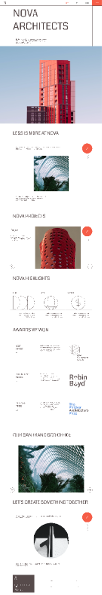

# NOVA Architects — Architecture & Urban Spatial Studio (34-Amaliy Ish)

Figma dizaynining yuqori aniqlikdagi (**Pixel-Perfect**) to'liq, zamonaviy, interaktiv va to'liq moslashuvchan (fully responsive) me'morchilik va shaharsozlik studiyasi platformasi: **NOVA Architects (node-id: 0:1)**.

[-F24E1E?logo=figma&logoColor=white)](https://www.figma.com/file/L2f6Ex8oLNYwqS5R7IY9C2/Nova?type=design&node-id=0%3A1&mode=design&t=slIClXPsUOKprK4T-1)

---

## 📸 Figma Dizayn Ko'rinishi (Master Canvas)

---

## 📌 Loyiha Haqida

Ushbu loyiha Figma platformasidagi **Nova (NOVA Architects)** dizaynining to'liq ekotizimi va dizayn tokenlari (node-id: `0:1`) asosida 100% aniqlik bilan ishlab chiqildi. Sayt xalqaro darajadagi zamonaviy osmono'par binolar, jamoat maydonlari, muzeylar hamda taktil interyer arxitekturasini loyihalashtiruvchi **NOVA Architects** studiyasining rasmiy ko'p funksiyali veb-platformasidir.

- **Figma Manzili**: [Nova — node-id: 0:1](https://www.figma.com/file/L2f6Ex8oLNYwqS5R7IY9C2/Nova?type=design&node-id=0%3A1&mode=design&t=slIClXPsUOKprK4T-1)
- **Topshiriq**: 34-Amaliy Ish
- **GitHub Repozitoriyasi**: [https://github.com/soxibs48-eng/amaliy34](https://github.com/soxibs48-eng/amaliy34)
- **Til**: To'liq o'zbek tilida (100% professional me'moriy atamalar bilan)

---

## ✨ Asosiy Imkoniyatlar va Bo'limlar

1. **Header & Navbar**:
   - Geometrik monogramma logotipi (`NOVA`).
   - Sahifalar bo'ylab tezkor silliq navigatsiya (Bosh sahifa, Falsafa, Loyihalar, Yutuqlar, Mukofotlar, Ofisimiz, Aloqa).
   - Tungi va Kunduzgi rejim (Dark/Light mode switch) `localStorage` xotirasi bilan.
   - Mobil qurilmalar uchun moslashuvchan interaktiv gamburger menyu.

2. **Hero Banner**:
   - Katta tipografik me'moriy sarlavha (`NOVA ARCHITECTS`).
   - Qizil terrakota osmono'par minoraning me'moriy surati.
   - Studiya manifesti va taklifi.

3. **Me'moriy Falsafa ("Less is More at NOVA")**:
   - Bioklimatik shaffof gumbaz interyer fotosi.
   - Minimalizm va barqarorlik falsafasi.
   - Yumaloq interaktiv harakat tugmasi.

4. **NOVA Loyihalari Vitrinasi (Projects Slider)**:
   - Dinamik JavaScript slayderi: Aurora Tower (Tokio), Sfera Muzeyi (San-Fransisko), Apex Horizon (London).
   - Har bir loyihaning lokatsiyasi, maydoni, balandligi va holati metrikalari.

5. **Yutuqlar va Metrikalar (NOVA Highlights)**:
   - 150+ global obyektlar, 32 ta xalqaro mukofot, 100% BREEAM/LEED sertifikatsiyasi.
   - Ekranga chiqqanda avtomatik hisoblovchi animatsiya (IntersectionObserver).

6. **Erishilgan Mukofotlar (Awards We Won)**:
   - Pritzker Architecture Prize, Robin Boyd Award, AIA Honor Award, MCHAP jadvallari.

7. **San-Fransisko Ofisi Ko'rinishi (Office Carousel)**:
   - Ofis binosi va me'moriy laboratoriya galereyasi.

8. **Interaktiv Konsultatsiya Formasi**:
   - Ism, pochta, loyiha toifasi va tafsilotlarini kiritish va tasdiqlovchi bildirishnoma.

9. **Professional Futer**:
   - San-Fransisko, Tokio, London va Toshkentdagi ofislar, tarmoqlar va mualliflik huquqi.

---

## 🛠 Texnologiyalar Steki

- **HTML5**: Semantik, qulay (WAI-ARIA) va SEO uchun optimallashgan teglash tizimi.
- **CSS3**: Maxsus dizayn tokenlari, CSS Grid, Flexbox, Fluid Typography (`clamp`), dark mode o'zgaruvchilari.
- **Vanilla JavaScript (ES6+)**:
  - `initTheme()` — Tungi va kunduzgi rejimni boshqarish.
  - `initProjectsSlider()` — Loyihalar slayderi.
  - `initOfficeSlider()` — Ofis galereyasi slayderi.
  - `initCounters()` — Dinamik hisoblagichlar.
  - `initContactForm()` — Konsultatsiya formasi.
- **Vercel**: `vercel.json` orqali toza URL manzillari bilan global joylashtirishga tayyor.

